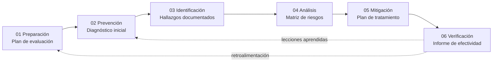

# FORTIS — Framework metodológico de ciberseguridad

FORTIS organiza la evaluación técnica de seguridad en un **ciclo iterativo de seis fases** con enfoque **Purple Team**:
cada prueba ofensiva autorizada se ejecuta en paralelo con la detección defensiva, y cada hallazgo se traza hasta la
verificación del control que lo corrige.

> Versión del documento: **0.3** (noviembre de 2026). Ver [CHANGELOG](CHANGELOG.md).

## Ciclo metodológico



## Estructura del repositorio

| Carpeta | Contenido |
|---|---|
| `docs/` | Framework, arquitectura, metodología y glosario |
| `framework/fases/` | Especificación de cada fase (objetivo, entradas, salidas, responsable) |
| `framework/protocolos/` | Reglas de compromiso y protocolo de cadena de custodia |
| `framework/matrices/` | Anexos A–D en CSV (casos, hallazgos, evidencias, mitigación) y rúbrica de severidad |
| `laboratorios/` | Un directorio por laboratorio FC-LAB, con ficha, procedimiento, evidencias y resultados |
| `scripts/` | Utilidades: registro de evidencias con SHA-256 y cálculo de severidad |
| `plantillas/` | Ficha estandarizada de laboratorio (sección 10.1) |
| `casos-estudio/` | Caso piloto OWASP Juice Shop (sección 12.1) |
| `resultados/` | Informes de cada ciclo (solo material anonimizado) |

## Catálogo de laboratorios

| ID | Laboratorio | Dominio | Enfoque | Estado |
|---|---|---|---|---|
| [FC-LAB-001](laboratorios/lab-01-shell/) | Comandos Shell y Kali Linux | D01 | Transversal | Documentado (v1.0) |
| [FC-LAB-002](laboratorios/lab-02-dns/) | DNS Footprinting con nslookup y dig | D02 | Ofensivo controlado | Documentado (v1.0) |
| [FC-LAB-003](laboratorios/lab-03-httrack/) | Clonación controlada HTTrack | D03 | Ofensivo/defensivo | Documentado (v1.0) |
| [FC-LAB-004](laboratorios/lab-04-esteganografia/) | Esteganografía con Steghide: partes 1–3 | D06 | Forense y colaborativo | Documentado (v1.0) |
| [FC-LAB-005](laboratorios/lab-05-ingenieria-social/) | Ingeniería social: principios | D05 | Factor humano | Documentado (v1.0) |
| [FC-LAB-006](laboratorios/lab-06-maltego/) | Maltego: instalación y aplicación | D02 | OSINT | Documentado (v1.0) |
| [FC-LAB-007](laboratorios/lab-07-burp/) | Burp Suite | D03/D04 | Pruebas web | Documentado (v1.0) |
| [FC-LAB-008](laboratorios/lab-08-deteccion/) | Detección y análisis de registros (nginx) | D07 | Defensivo / Purple | Documentado (v1.0) |
| [FC-LAB-009](laboratorios/lab-09-apis/) | Pruebas de APIs REST: autenticación y control de acceso | D04 | Ofensivo controlado | Propuesto |
| [FC-LAB-010](laboratorios/lab-10-ia-prompt-injection/) | Prompt injection en aplicaciones con LLM | D08 | Seguridad de IA | Propuesto |
| [FC-LAB-011](laboratorios/lab-11-forense/) | Adquisición forense, hashing y cadena de custodia | D06 | Forense | Propuesto |
| [FC-LAB-012](laboratorios/lab-12-phishing/) | Simulación de phishing autorizada (GoPhish) | D05 | Factor humano | Propuesto |
| [FC-LAB-013](laboratorios/lab-13-juice-shop/) | Caso integrador Purple Team: OWASP Juice Shop | D03/D04/D07 | Purple Team | En ejecución |

## Uso rápido

```bash
# Registrar una evidencia (calcula SHA-256 y la agrega al anexo C)
python scripts/registrar_evidencia.py ruta/al/archivo.png --caso CP-JS-01 --desc "Cabeceras HTTP" --por "Analista ofensivo"

# Calcular severidad con la rúbrica 13.1
python scripts/severidad.py 3 4
```

## Principios rectores

Autorización expresa · Proporcionalidad · Mínimo impacto · Confidencialidad · Reproducibilidad · Integridad de evidencias · Mejora continua.

**Ninguna prueba de este repositorio debe ejecutarse sin autorización escrita del responsable del sistema evaluado.**
Los laboratorios usan entornos propios, aplicaciones de entrenamiento y datos sintéticos.

## Contribuir

Flujo con ramas `feature/`, `docs/` y `fix/`, Pull Request con una revisión y commits con prefijos `feat`, `fix`, `docs`,
`refactor` y `chore`. Ver [docs/guia-github.md](docs/guia-github.md).
