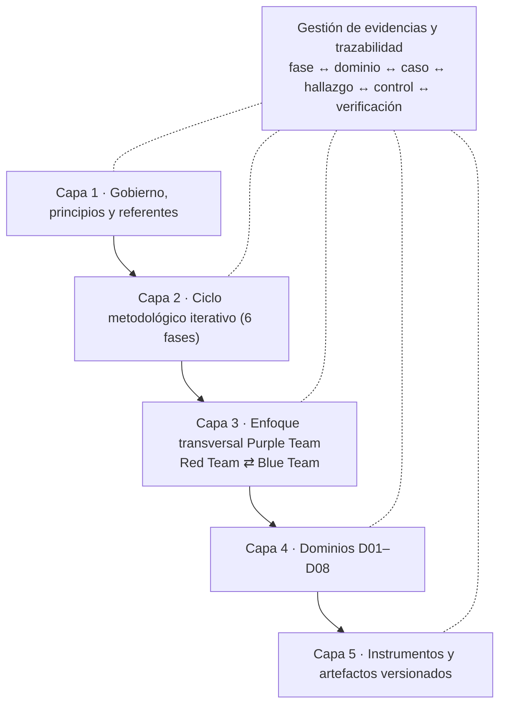

# Arquitectura metodológica

| Capa | Contenido |
|---|---|
| 1 · Gobierno | Principios rectores y referentes normativos |
| 2 · Ciclo | Preparación → Prevención → Identificación → Análisis → Mitigación → Verificación |
| 3 · Purple Team | Pruebas ↔ detección ↔ mejora de controles |
| 4 · Dominios | D01 a D08 (ver [metodologia.md](metodologia.md#dominios)) |
| 5 · Instrumentos | Laboratorios FC-LAB, ficha estandarizada, matrices, registro de evidencias, plan de mitigación, repositorio |
